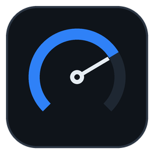

# AutoDiag Pro


[](https://github.com/ausgreekdev-cpu/autodiag-pro/releases/latest)

<p align="center">
  
</p>

**OBD-II scan tool** — desktop diagnostics app for ELM327 adapters (USB / Bluetooth SPP).

Dark-themed PySide6 dashboard that talks to your car's ELM327 adapter over a serial
port (USB cable or paired Bluetooth SPP dongle).

## Features

- **Overview dashboard** — the launch landing page: connection status with live
  voltage, VIN and supported-parameter count, trouble-code totals, emissions
  readiness (MIL + monitor completion), your last saved session, and one-click
  shortcuts into the panels
- **Live data** — engine RPM, speed, coolant, load, fuel trims, O2 sensors (voltage
  **and** short-term fuel trim per sensor)... the full standard SAE J1979 registry
  (160 channels) filtered to what the vehicle reports as supported (`0100`
  bitmaps), four headline gauges + a scrolling graph of any ticked parameters;
  on CAN buses up to **6 PIDs are requested per transaction** (batched multi-PID
  polling), refreshing the full set about 6× faster than one-at-a-time requests
- **Threshold alerts** — watch any parameter against a min/max limit while
  polling: the dashboard cell lights amber on a crossing, the status bar
  flashes the reading vs. the limit, and every excursion lands in an Alerts
  event list you can export as CSV (thresholds persist across launches)
- **Trouble codes** — read stored (`03`), pending (`07`) and permanent (`0A`) DTCs
  with plain-English descriptions (10,497-code bundled dictionary); clear codes (`04`,
  MIL off) with confirmation; select a code for **local repair guidance** — likely
  causes, first checks, and the freeze-frame conditions when it was set (offline
  heuristics, included in reports)
- **Readiness monitors** — I/M status: check emissions readiness before a smog test
- **Freeze frame** — sensor snapshot captured when a fault was set (`02`), with a
  frame 0/1/2 picker
- **Vehicle info** — VIN, calibration IDs, CVN (`09`), plus OBD standard and
  fuel type (`01 1C`/`01 51`); an optional *Look up VIN (NHTSA)* button
  decodes the VIN (make/model/year/engine) and lists open safety recalls
- **Mode $06** — onboard test results (monitor + standardized test name vs. the
  min/max limits the ECU used, PASS/FAIL), with an *Only failures* filter
- **Mode $05** — oxygen-sensor monitor test results for non-CAN buses
  (ISO 9141 / J1850 / KWP; on CAN these tests surface in Mode $06)
- **Reports** — export everything collected to JSON, CSV, a single
  shareable HTML page, or a print-ready PDF (rendered offline from the
  same HTML — no cloud services)
- **Resilient link** — if the adapter drops mid-session the app reconnects by itself
  (1–15 s backoff, up to 5 attempts) with live status in the window
- **Remembers your setup** — last port, poll interval, panel and window layout are
  restored on launch; tick *Auto* in the toolbar to reconnect without clicking
- **Find parameters fast** — dashboard search (name or hex PID) + category filter
- **Graph snapshots** — save the live graph as a PNG (*Save image…*)
- **Graph windows + pause** — pick the visible time window (30 s / 2 min /
  10 min / All), freeze the plot with *Pause* while values keep logging, or
  start over with *Clear*
- **Every ECU's codes** — multi-ECU mode $03/$07/$0A replies are parsed per
  message, so a second ECU never produces phantom DTCs
- **Session history** — every scan auto-saves to disk on close (last 50 kept);
  browse, preview, re-export as JSON/CSV/HTML/PDF, attach a work order
  (customer, phone, mileage, job, notes) to any session, or delete.
  Crash-safe: the in-progress session is persisted every 30 s and restored
  on next launch if the app didn't close cleanly
- **Time-series CSV logs** — every polled value streams into a timestamped CSV
  (*Log*, on by default; newest 50 kept) and the matching history session links
  back to it
- **In-app log review** — the Log viewer charts any saved CSV: parameter picker,
  hover cursor readout, PNG export; jump straight from a history session's
  *View log…* button
- **Session compare** — diff any two saved sessions: codes added/removed,
  readiness and MIL flips, Mode $05/$06 pass/fail changes, freeze-frame
  value changes, live-value deltas, plus a warning when the two VINs differ
- **PID explorer** — request any parameter on demand and see the raw response
  beside the decoded value; *Force* sends unsupported PIDs too, and one click
  pins the parameter to the dashboard graph
- **UDS (ISO 14229) requests** — read-only diagnostic services ($10 session,
  $19 DTCs with code/status decode, $22 read-DID with VIN/ASCII decode,
  $3E tester present) against any physical CAN ID (7E0, 7E1, …); ECU presets
  and custom hex are allowed, CAN headers are restored after every exchange,
  and each request is recorded in session history and the JSON/CSV/HTML
  reports. Write services ($2E/$31/$2F) exist but stay behind an explicit
  waiver checkbox and a per-send confirmation dialog. Active-test outcomes
  (Mode $08) land in the session record and every export; a curated preset
  library covers common $2F/$31 controls with one-click run
- **Security gateway (SGW) unlock** — probe the gateway module (Ford-style
  7E2), request its $27 security seed, paste the key computed by an
  authorized tool (FORScan, AutoAuth-certified software) and send it back;
  the app tracks the ~30-minute unlock window. Ford seed-key algorithms
  (legacy LFSR + HMAC-SHA1) are built in for one-click key computation
  where the per-ECU secret is known. Same waiver + Workshop gate
  as write services
- **Active tests (Mode $08)** — one-click bi-directional controls for the
   public SAE J1979-DA test set (EVAP leak test, EGR, O2 sensors) plus custom
   test IDs; each run shows a confirmation of exactly what the ECU will
   actuate, and the outcome (accepted / NRC) lands in the request log — same
   waiver + Workshop gate as write services
- **Update check** — press *Check for updates* in Settings (or run
  `autodiag updates`) to compare against the latest GitHub release; one
  request, only when you ask
- **VIN lookup** — press *Look up VIN (NHTSA)* on the Vehicle info panel to
  decode the VIN through the official DOT vPIC service and list open NHTSA
  safety recalls for the decoded make/model/year; two HTTPS requests, only
  when you ask
- **Command-line tools** — headless `autodiag doctor` adapter smoke test
  (works without a car) and `autodiag scan` report generation

Fully offline: no accounts, no servers — everything runs on your machine.
The only optional network calls are the update check and the NHTSA VIN
lookup, both ones you trigger yourself.

## Download

Prebuilt binaries for every release are on the
[Releases page](https://github.com/ausgreekdev-cpu/autodiag-pro/releases):

- **Linux (x86_64)** — `autodiag-linux-x86_64`: `chmod +x autodiag-linux-x86_64 && ./autodiag-linux-x86_64`
- **Windows (x86_64)** — `autodiag-windows-x86_64.exe`: double-click (SmartScreen may
  ask "More info → Run anyway" for unsigned builds)

Binaries are built by CI (`.github/workflows/release.yml`) on the tag — see
*Packaging a standalone executable* below to build from source instead.

## Editions & licensing

AutoDiag Pro is **free** for generic OBD-II diagnostics — live gauges,
reading and clearing codes, CSV/HTML exports, guided basics.

| | Free | Pro $34 | Workshop $49/mo |
|---|---|---|---|
| Live gauges, read/clear codes, CSV & HTML export | ✓ | ✓ | ✓ |
| Session history | last 10 | full | full |
| UDS module reads ($10/$19/$22), PDF reports | — | ✓ | ✓ |
| UDS write services, work orders, SGW unlock | — | — | ✓ |
| Mode $08 active tests | — | — | ✓ |

Unlock with a signed licence key via *Settings → Install licence key…*
(the *Upgrade in Store…* button deep-links to the Store listing once its
Product ID is set in Settings). The first launch
asks you to accept the safety notice & [EULA](docs/eula.md); everything
stays offline — key checks are local Ed25519 verification.

## Status

| Milestone | Status |
|---|---|
| 1. Project bootstrap (tooling, CI) | done |
| 2. ELM327 session + serial transport | done |
| 3. Decoders (PIDs, DTC, freeze, readiness, VIN, Mode 05/06) | done |
| 4. Worker thread + polling scheduler | done |
| 5. UI core (dashboard, gauges, live graph) | done |
| 6. Diagnostic panels + settings + export | done |
| 7. Packaging (PyInstaller) + docs | done |
| 8. Persistence + UX polish (v0.3.0) | done |
| 9. Decoder hardening + session history (v0.4.0) | done |
| 10. Live-data CSV logger (v0.5.0) | done |
| 11. Log viewer (v0.6.0) | done |
| 12. Session compare (v0.7.0) | done |
| 13. CLI + hardware smoke test (v0.8.0) | done |
| 14. Graph windows + pause (v0.9.0) | done |
| 15. PID explorer (v0.10.0) | done |
| 16. Packaging polish (v0.11.0) | done |
| 17. Update check (v0.12.0) | done |
| 18. Overview dashboard (v0.13.0) | done |
| 19. Threshold alerts (v0.14.0) | done |
| 20. Euro-complete generic layer + protocol pinning (v0.15.0) | done |
| 21. Mode $05 O2 monitor tests (v0.16.0) | done |
| 22. Mode $05 compare + full PID registry (v0.17.0) | done |
| 23. Single-file HTML diagnostic report (v0.18.0) | done |
| 24. Freeze-frame compare (v0.18.0) | done |
| 25. UDS read-only requests (v0.19.0) | done |
| 26. UDS session history + reports (v0.20.0) | done |
| 27. UDS write services with waiver (v0.21.0) | done |
| 28. PDF export + session work orders (v0.22.0) | done |
| 29. Microsoft Store MSIX packaging (v0.22.0) | done |
| 30. Freemium licensing + EULA (v0.23.0) | done |
| 31. VIN decode + NHTSA recall lookup (v0.23.0) | done |
| 32. Batched multi-PID polling + STN profile (v0.23.0) | done |
| 33. Local guided repair advice (v0.23.0) | done |
| 34. Mode $08 bi-directional active tests (v0.23.0) | done |
| 35. AutoAuth SGW unlock assistant (v0.23.0) | done |
| 36. Active-test reports + UDS preset library (v0.23.0) | done |
| 37. Ford SGW seed-key computation (v0.23.0) | done |
| 38. Session auto-recovery (crash-safe saves) (v0.24.0) | done |

## Install & run

```bash
python3 -m venv .venv
source .venv/bin/activate
pip install -e ".[dev]"

autodiag            # or: python -m autodiag
```

## Using the app

1. **Plug in the adapter** — USB serial, or pair the Bluetooth SPP dongle in your OS
   settings first (typical PIN `1234`/`0000`).
2. **Overview** — the landing page: connection status and live voltage, VIN with
   the supported-parameter count, trouble-code totals, emissions readiness, your
   last saved session, and quick-action buttons into the other panels. Fresh
   installs open here; once you pick a panel it is remembered.
3. **Pick the port** in the toolbar (press *Refresh* if it is not listed) and press
   **Connect**. The app auto-detects the baud rate, initializes the ELM327 and
   discovers which PIDs the vehicle supports. Tick *Auto* to reconnect to this port
   automatically on the next launch — the poll interval and window layout are
   remembered either way.
4. **Dashboard** — gauges and the value table update live; the poll interval (default
   250 ms) controls request spacing. Tick rows to graph those parameters, use
   *Filter parameters…* / the category dropdown to narrow the table, and *Save
   image…* to export the graph as a PNG. The *Window* dropdown limits the graph
   to the last 30 s / 2 min / 10 min (or *All* of the buffer), *Pause* freezes
   the plot without stopping the poll or the log, and *Clear* erases it. The
   *Log* checkbox (on by default) appends
   every polled value to a CSV in the app-data `logs/` folder — the label beside it
   shows the current file and row count; untick it to stop. Failed PIDs are dropped
   automatically after 3 timeouts, and a lost adapter connection is retried by itself
   (1 s → 15 s backoff, 5 attempts).
5. **Trouble codes** — press *Read codes*; switch tabs for pending/permanent.
   *Clear codes* asks for confirmation first.
6. **Readiness / Freeze frame / Vehicle info / Mode $05 / Mode $06** — each panel
   has its own read button; results stay available for the report. The freeze-frame
   panel can read any of frames 0–2 and keeps each frame cached for comparison.
   On *Vehicle info*, *Look up VIN (NHTSA)* decodes the VIN and fetches open
   safety recalls (offline mode simply reports the failure).
7. **Settings** — export the whole session (VIN, codes, monitors, Mode $05/$06,
   latest readings) as JSON, CSV, HTML or PDF, pin the OBD protocol if auto-detection fails or
   picks the wrong one, or press *Check for updates* to compare the running version
   with
   the latest GitHub release.
8. **History** — past sessions appear here automatically when you close the app
   (the newest 50 are kept). Select one to preview it, re-export it as
   JSON/CSV/HTML/PDF, attach a *Work order…* (customer, phone, mileage, job and
   notes stored with the session and shown in every export), or delete it; the
   *Log* column shows which sessions have a CSV time series,
   and *View log…* opens one straight in the Log viewer. *Compare…* opens two
   sessions side by side — codes gained/lost, readiness flips, test changes
   and value deltas — defaulting to your selection against the newest other
   session.
9. **Log viewer** — pick any recorded log (or *Browse…* for a CSV elsewhere),
   tick parameters to plot them, hover the graph for a cursor readout, and
   *Export image…* to save the chart as a PNG.
10. **PID explorer** — pick any supported parameter (the rest of the SAE
    registry is listed too, marked *unsupported* and gated behind *Force*),
    press *Request* to see the raw response next to the decoded value, and
    *Graph this PID* to tick it in the dashboard graph.
11. **Alerts** — set a min/max limit on any parameter (before or during a
    session; supported ones are listed first). Crossings highlight the
    dashboard value in amber, flash in the status bar and collect here with
    the time, value and limit; *Export CSV…* saves the history, and the
    thresholds themselves are remembered between launches.
12. **UDS** — pick an ECU preset (or set the physical header yourself; the
    response ID follows TX + 8, e.g. `7E0` → `7E8`), then send read-only
    ISO 14229 requests via the preset buttons, the known-DID picker (VIN
    `F190` first) or raw hex; $19 responses decode to DTC + status, results
    appear above the raw response, and every exchange is saved with the
    session for history and reports. Write services ($2E write DID, $31
    routine, $2F IO control) unlock only after ticking the waiver checkbox,
    and every write still asks for a final confirmation

## Command-line tools

The same `autodiag` entry point doubles as a headless CLI (no GUI, no Qt):

```bash
autodiag ports                # list serial ports
autodiag doctor               # adapter smoke test: banner, voltage, baud
autodiag doctor --vehicle     # ... + 0100 bus probe (ignition on)
autodiag scan -o report.json  # full headless scan → JSON/CSV/HTML report
autodiag updates              # compare against the latest GitHub release
```

- **ports** — every serial device the OS knows about (USB serial + paired BT SPP).
- **doctor** — verifies an ELM327 **without a vehicle**: reset banner, adapter id,
  voltage, auto-baud. Exit code 0 = PASS, 1 = FAIL, so it works in scripts.
  `--vehicle` additionally probes the bus (`0100`) and reports whether a vehicle
  answered (not required for PASS).
- **scan** — connects, reads VIN/DTCs/readiness/freeze frame/Mode $06, then polls
  live PIDs (`--pids`, default `0C,0D,05`) for `--seconds` (default 5) at
  `--interval` and writes the report. `--device` picks the port (defaults to the
  only port present); output defaults to `autodiag-scan-<timestamp>.json`.
  `-o path.html|csv|json` picks the format — PDF export lives in the app
  (Settings or History), not the CLI.
- **updates** — one GitHub API request; prints the newer release (with URL) or
  "You're up to date". Exit code 0 = checked, 1 = the check failed.

Both `autodiag ...` and `python -m autodiag ...` work. On Windows prefer the
pip-installed `autodiag` script — the bundled `.exe` is a windowed GUI build.

## Development

```bash
ruff check .        # lint
pytest -q           # unit tests (no hardware needed — ELM327 fakes)
```

Tests run entirely against scripted fake adapters (`tests/fakes.py`), so no OBD
hardware is required. UI tests use Qt's offscreen platform. Seeded fuzz tests
(`tests/test_fuzz_decoders.py`) hammer every decoder with random garbage —
fixed seed, reproducible, contract-checked return types.

## Packaging a standalone executable

```bash
pip install -e ".[dev]"
pyinstaller --noconfirm autodiag.spec
./dist/autodiag                 # one-file executable (dist/autodiag.exe on Windows)
```

Requirements:

- **binutils** (`objdump` + `objcopy`) — part of any normal Linux build environment
  (`apt install binutils` / `dnf install binutils`)
- On Windows the spec produces `dist\autodiag.exe` with no extra tools

The build bundles the DTC dictionary, all Qt runtime libraries and pyqtgraph.
Building for a different OS must be done on that OS (PyInstaller does not
cross-compile).

### Microsoft Store (MSIX)

The paid Store version is an MSIX package around the same Windows exe
(manifest + Store logos generated by `packaging/msix/`). CI builds a private
`autodiag-msix` artifact on every tag; Partner Center signing and licensing
(trial, updates) are handled by Microsoft. See `docs/store/STORE.md` for the
submission runbook and `docs/privacy-policy.md` for the Store privacy policy
draft.

## Hardware

Any ELM327-compatible adapter with a serial profile:

- **USB** — appears as `/dev/ttyUSB0` (Linux) or `COMx` (Windows)
- **Bluetooth SPP** — pair it in your OS settings first (e.g. PIN `1234` or `0000`),
  then pick the paired port in the app

Cheap ELM327 v1.5/v2.1 clones work; common baud rates (38400/57600/115200) are
auto-detected.

## Troubleshooting

| Symptom | Likely cause / fix |
|---|---|
| "Vehicle did not respond" | Ignition must be ON (engine may be off); check the adapter is fully seated |
| "No ELM327 response" on every port | Wrong port, or the dongle needs a different baud (the app tries 38400/115200/57600/9600) |
| Port missing from the list | Linux: add yourself to the `dialout` group, re-plug; Bluetooth: pair the SPP device first |
| Values stuck at `--` | Vehicle may not support those PIDs — the table only shows supported ones |
| CAN errors while polling | Slow the poll interval down (e.g. 500 ms) |
| UDS request answered `?` or `NO DATA` | Clone ELM327 units often reject the custom `AT SH`/`AT CRA` headers UDS needs — STN1110, OBDLink and vLinker adapters support them |
| Connection lost mid-scan | The app reconnects by itself (5 attempts over ~30 s); if it gives up, press *Connect* again |

## Project layout

```
autodiag/
  transports/   byte-pipe Transport ABC + serial (USB/BT SPP) implementation
  obd/          ELM327 session, response framing, J1979 decoders, DTC dictionary
  services/     ObdEngine loop, Qt worker thread, scan record, report export
  ui/           theme, main window, panels (dashboard/DTC/readiness/...), widgets
  data/         bundled data files (DTC descriptions + license)
tests/          pytest suite (fake serial / fake ELM327 / offscreen UI tests)
packaging/      Windows version-info + icons + MSIX (Microsoft Store) packaging
docs/           privacy policy draft + Store submission runbook
autodiag.spec   PyInstaller build recipe
```

Architecture in one paragraph: `ObdEngine` (pure Python) owns the ELM327 session —
it executes queued jobs (connect, read codes, ...) and round-robin-polls live PIDs,
dropping the link and auto-reconnecting with backoff when the transport fails.
`ObdWorker` runs it on a `QThread` and re-emits results as Qt signals. Panels
subscribe to those signals; `ScanRecord` accumulates everything for reports.
Everything speaks SAE J1979 (modes $01–$0A) — no cloud services anywhere.

## License

See repository for license details. The bundled DTC dictionary (10,497 codes)
originates from an Apache-2.0 npm package — see
`autodiag/data/LICENSE-dtc-data.txt` — and was audited and gap-filled against
two open SAE J2012 transcriptions: OBDex (CC0-1.0) supplied added
descriptions, and Wal33D/dtc-database (MIT) was used to verify code existence
plus 129 body/chassis additions. Placeholder entries ("Manufacturer
Controlled DTC") were deliberately not imported.
